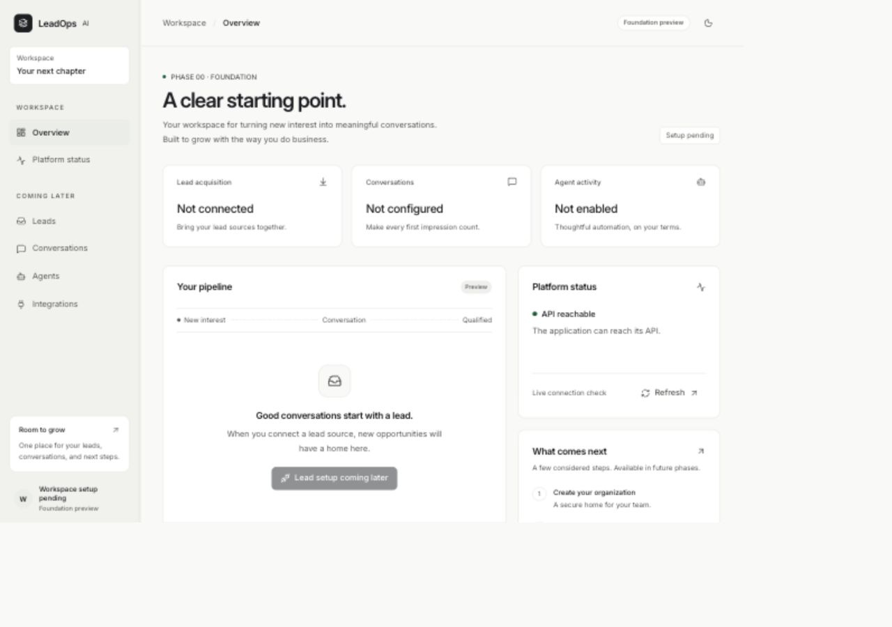

# Phase 00 engineering report

Date: October 29, 2026 (America/New_York). Status: implemented within the approved Phase 00 scope. No Phase 01 work, cloud provisioning, production credentials, deployments, commits or pushes were performed.

## 1. Executive summary

The empty `lead_gen` directory is now a private pnpm/Turborepo monorepo with a polished React workspace preview, a minimal Fastify API, reusable UI primitives, shared validated wire contracts, consistent tooling, meaningful tests, CI configuration, security scanning, and implementation-specific architecture/learning documentation.

The only live application capability is API reachability through a centralized typed client. Product areas are clearly labeled as preview/setup pending. No fake leads, production metrics, login state, organization membership or agent activity are presented as real. The application runs without external services or secrets. This foundation is not production-security ready and must not hold customer data yet.

## 2. Final repository tree

The tree below lists every new source/configuration/documentation artifact. Generated `node_modules`, `dist`, `.turbo`, `.tools`, and the initialized `.git` directory are excluded. Deferred packages and empty schema directories do not exist.

```text
lead_gen/
├── .github/
│   └── workflows/
│       └── ci.yml
├── apps/
│   ├── api/
│   │   ├── src/
│   │   │   ├── app/
│   │   │   │   └── create-app.ts
│   │   │   ├── config/
│   │   │   │   └── env.ts
│   │   │   ├── modules/
│   │   │   │   └── health/
│   │   │   │       └── routes.ts
│   │   │   ├── plugins/
│   │   │   │   ├── errors.ts
│   │   │   │   └── logging.ts
│   │   │   └── server.ts
│   │   ├── test/
│   │   │   ├── app.test.ts
│   │   │   └── env.test.ts
│   │   ├── .env.example
│   │   ├── package.json
│   │   ├── tsconfig.build.json
│   │   └── tsconfig.json
│   └── web/
│       ├── public/
│       │   └── favicon.svg
│       ├── src/
│       │   ├── app/
│       │   │   ├── app.test.tsx
│       │   │   ├── app.tsx
│       │   │   ├── error-boundary.tsx
│       │   │   ├── navigation.tsx
│       │   │   ├── shell.tsx
│       │   │   └── use-theme.ts
│       │   ├── components/
│       │   │   ├── empty-state.tsx
│       │   │   ├── error-state.tsx
│       │   │   └── loading-state.tsx
│       │   ├── features/
│       │   │   └── system-status/
│       │   │       ├── health-card.tsx
│       │   │       └── use-health.ts
│       │   ├── lib/
│       │   │   ├── api-client.test.ts
│       │   │   ├── api-client.ts
│       │   │   └── env.ts
│       │   ├── routes/
│       │   │   ├── dashboard.tsx
│       │   │   ├── not-found.tsx
│       │   │   └── status.tsx
│       │   ├── styles/
│       │   │   └── global.css
│       │   ├── test/
│       │   │   ├── setup.ts
│       │   │   └── vitest.d.ts
│       │   └── main.tsx
│       ├── .env.example
│       ├── index.html
│       ├── package.json
│       ├── tsconfig.json
│       └── vite.config.ts
├── docs/
│   ├── architecture/
│   │   ├── agents.md
│   │   ├── monorepo.md
│   │   ├── multi-tenancy.md
│   │   └── overview.md
│   ├── decisions/
│   │   ├── 0001-modular-monorepo.md
│   │   ├── 0002-runtime-and-dependencies.md
│   │   ├── 0003-trusted-organization-context.md
│   │   └── 0004-health-and-agent-scope.md
│   ├── learning/
│   │   └── phase-00.md
│   ├── phases/
│   │   ├── assets/
│   │   │   └── phase-00-overview.jpg
│   │   └── phase-00-report.md
│   └── security/
│       └── threat-model.md
├── packages/
│   ├── config/
│   │   ├── typescript/
│   │   │   └── base.json
│   │   ├── eslint.js
│   │   └── package.json
│   ├── shared/
│   │   ├── src/
│   │   │   └── index.ts
│   │   ├── test/
│   │   │   └── contracts.test.ts
│   │   ├── package.json
│   │   ├── tsconfig.build.json
│   │   └── tsconfig.json
│   └── ui/
│       ├── src/
│       │   ├── button-variants.ts
│       │   ├── button.tsx
│       │   ├── card.tsx
│       │   ├── cn.ts
│       │   ├── index.ts
│       │   └── tokens.css
│       ├── test/
│       │   └── button.test.tsx
│       ├── package.json
│       ├── tsconfig.build.json
│       └── tsconfig.json
├── scripts/
│   ├── check-boundaries.mjs
│   ├── check-boundaries.test.mjs
│   └── secret-scan.mjs
├── supabase/
│   └── README.md
├── .env.example
├── .gitignore
├── .gitleaks.toml
├── .nvmrc
├── .prettierignore
├── .prettierrc.json
├── README.md
├── THIRD_PARTY_NOTICES.md
├── eslint.config.js
├── package.json
├── pnpm-lock.yaml
├── pnpm-workspace.yaml
└── turbo.json
```

## 3. Files created or changed

The workspace began empty, so **all 87 listed files are new**; there was no existing application to overwrite. The complete file inventory is the tree above. Key implementation entry points:

| Responsibility                      | Files                                                                                                               |
| ----------------------------------- | ------------------------------------------------------------------------------------------------------------------- |
| Runtime and reproducibility         | `.nvmrc`, `package.json`, `pnpm-workspace.yaml`, `pnpm-lock.yaml`, `turbo.json`                                     |
| Shared tooling                      | `packages/config/typescript/base.json`, `packages/config/eslint.js`, `eslint.config.js`, `.prettierrc.json`         |
| Contracts                           | `packages/shared/src/index.ts`                                                                                      |
| API startup and transport           | `apps/api/src/server.ts`, `apps/api/src/app/create-app.ts`                                                          |
| API configuration and safe failures | `apps/api/src/config/env.ts`, `apps/api/src/plugins/errors.ts`, `apps/api/src/plugins/logging.ts`                   |
| API health                          | `apps/api/src/modules/health/routes.ts`                                                                             |
| Browser composition                 | `apps/web/src/app/`, `apps/web/src/routes/`, `apps/web/src/components/`                                             |
| Centralized HTTP                    | `apps/web/src/lib/api-client.ts`, `apps/web/src/lib/env.ts`                                                         |
| Health feature                      | `apps/web/src/features/system-status/`                                                                              |
| UI system                           | `packages/ui/src/`, `apps/web/src/styles/global.css`, `THIRD_PARTY_NOTICES.md`                                      |
| Regression tests                    | API tests, frontend tests, shared contracts, Button behavior, `scripts/check-boundaries.test.mjs`                   |
| CI and supply chain                 | `.github/workflows/ci.yml`, `.gitleaks.toml`, `scripts/secret-scan.mjs`, `scripts/check-boundaries.mjs`             |
| Learning and architecture           | `docs/architecture/`, `docs/learning/phase-00.md`, four ADRs, `docs/security/threat-model.md`, `supabase/README.md` |

## 4. Architecture decisions, in educational terms

**The monorepo is one workshop with clearly marked workbenches.** The web app owns presentation, the API owns HTTP, `ui` owns reusable visual components, `shared` owns safe data contracts, and `config` owns tooling. They live together so one contract change can be checked at both ends. The boundary checker prevents reaching through another package's private files and detects dependency cycles. See ADR 0001 and the monorepo guide.

**Types and validation solve different problems.** A TypeScript health response type helps an engineer write correct code. It cannot guarantee that an HTTP response actually contains that shape. The shared Zod schema performs that check at runtime. Zod also produces JSON Schema for Fastify, avoiding another adapter dependency.

**The HTTP client is the browser's front door to the API.** Presentation asks `apiClient.getHealth()` for data. The client owns the origin, five-second deadline, cancellation, safe errors and schema parsing. The hook owns loading/retry lifecycle; the Card owns rendering. This keeps transport decisions out of every component and gives each layer a clear test seam. Web builds hash public environment settings and app environment files so cached output cannot silently keep an obsolete API origin.

**Identity, permission and isolation are three locks.** Authentication will verify the caller. Authorization will check current organization membership and operation permission. Database isolation will reinforce row and relationship scope through grants, RLS and tenant-aware constraints. One lock cannot replace another. All future tenant-owned operations must receive organization context derived by trusted backend code; frontend IDs and model text are requests, not authority. None of these tenant controls is implemented by a health route.

**Agents reason; applications authorize; workflows remember.** Future tools will bind to trusted organization context and apply policy before any external effect. A future durable workflow must persist progress, reconcile outcomes and retry idempotently. The Agents SDK will not be treated as a database permission system or durable job engine. See the agent architecture guide and ADRs 0003–0004.

**A testable server can exist without opening a port.** The Fastify factory is separate from `server.ts`. Most API tests inject HTTP requests directly into the factory; separate smoke checks verified the compiled entry point through actual local sockets.

Runtime and dependency decisions are recorded in ADR 0002: officially verified Node 26.13.0 LTS, pnpm 12.16.1, TypeScript 6.0.3, compatible library declarations, strict installation policy, and the reviewed UI source adaptation.

## 5. Security controls implemented

- Loopback defaults; no cloud, database, OpenAI, email or SMS execution.
- `.env`/credentials/local state ignores, safe environment examples, app-owned configuration.
- Server configuration validation at startup; errors name fields without echoing values. Production CORS requires explicit HTTPS origins.
- Exact-origin CORS without credentials or wildcards; no trusted proxy headers by default.
- Helmet API headers, a 16 KiB body limit, connection/request timeouts, graceful shutdown.
- Consistent safe errors and generated request IDs; no production stack traces, raw validation details or exceptions in responses.
- HTTP log serializers omit headers, query values and bodies; Pino redacts known sensitive fields. Tests verify credential and raw-error omission.
- Shared runtime contracts, a bounded/cancellable browser client, and safe UI error states.
- Explicit workspace dependency rules, Node/server import restrictions for browser-safe packages, module/package cycle checks, and restrictions on scattered fetch calls.
- Exact direct dependencies and a reproducible lockfile; strict peer/engine enforcement, 24-hour release age, no automatic peer installation, restricted dependency install scripts.
- Dependency auditing with high/critical blocking policy, visible lower-severity triage policy, and checksum-pinned Gitleaks with a detection canary.
- CI has read-only permissions, immutable action references, no persisted checkout credentials, no production secrets, and independent verification/audit/secret jobs.

## 6. Deferred security controls

Authentication/session design, authorization/membership resolver, tenant repositories, database grants/RLS/FKs, cross-tenant tests, audit records, worker scope enforcement, agent tooling/evaluations, signatures and replay defense, external-action idempotency, distributed/per-tenant rate limits, consent/opt-out enforcement, retention/deletion, provider credential encryption/rotation, monitoring and incident response, production frontend CSP/TLS/proxy configuration, operational backups/recovery.

There is no executable TenantContext abstraction pretending these controls exist. No server-only future package was created without a consumer. The threat model marks current mitigations and launch prerequisites separately.

## 7. Commands executed

The important setup and verification commands were:

```sh
node --version
pnpm --version
git --version
supabase --version
# Public official release/package metadata reads preceded installation.
source /Users/jonathanferreira/.nvm/nvm.sh
nvm install 26.13.0
nvm use 26.13.0
npm install --global pnpm@12.16.1
git init --initial-branch=main
pnpm install
pnpm install --frozen-lockfile
pnpm rebuild esbuild
pnpm exec turbo run build --filter=@leadops/shared --filter=@leadops/ui
pnpm exec turbo run typecheck --filter=@leadops/shared --filter=@leadops/ui
node scripts/check-boundaries.mjs
pnpm --filter @leadops/api typecheck
pnpm --filter @leadops/api test
pnpm --filter @leadops/api build
pnpm --filter @leadops/web typecheck
pnpm --filter @leadops/web test
pnpm --filter @leadops/ui typecheck
pnpm --filter @leadops/ui test
pnpm --filter @leadops/web build
pnpm format
pnpm verify
pnpm audit:dependencies
pnpm scan:secrets
pnpm dev
PORT=13001 NODE_ENV=production CORS_ORIGINS=https://app.example pnpm --filter @leadops/api start
pnpm --filter @leadops/web preview
VITE_API_BASE_URL=http://127.0.0.1:13001 pnpm exec turbo run build --filter=@leadops/web
pnpm exec turbo run build --filter=@leadops/web
git status --short --branch
git diff --check
```

Additional local checks exercised compiled startup rejection, real HTTP health/query/404/CORS behavior, built-SPA route fallback, environment-dependent build/cache separation, ignored-environment-file secret detection, internal documentation links, and browser interaction. A source inventory confirmed all application changes are untracked and unstaged. `git diff --check` has limited meaning with no tracked baseline; formatting and lint actually inspected the new source. No commit/push command ran.

## 8. Actual verification results

| Check                                  | Result                                                                                                                                                                                                           |
| -------------------------------------- | ---------------------------------------------------------------------------------------------------------------------------------------------------------------------------------------------------------------- |
| Official runtime verification          | Node release index marks v26.13.0 as LTS Lithium; nvm archive checksum matched                                                                                                                                   |
| Final `pnpm install --frozen-lockfile` | Exit 0; lockfile up to date; no peer conflicts or warning bypasses                                                                                                                                               |
| `pnpm verify`                          | Exit 0: formatting, lint/boundaries, strict typecheck, tests, all builds                                                                                                                                         |
| Node boundary regression tests         | 6 passed                                                                                                                                                                                                         |
| Shared contract tests                  | 2 passed                                                                                                                                                                                                         |
| UI Button tests                        | 3 passed: keyboard activation/no accidental submit, disabled behavior, link composition                                                                                                                          |
| API/environment tests                  | 21 passed: health, headers, query validation, safe routes/errors, body limit, malformed JSON, CORS/preflight, log redaction, startup settings                                                                    |
| Browser/client tests                   | 16 passed: app rendering/navigation, honest preview, loading/error/retry, theme persistence, 404 recovery, HTTP and payload failures, cancellation, unsafe URL rejection                                         |
| Total automated tests                  | **48 passed; 0 failed; 0 skipped**                                                                                                                                                                               |
| Dependency audit                       | Exit 0; **no known vulnerabilities found** at audit time, including development dependencies                                                                                                                     |
| Gitleaks                               | Exit 0; detection canary passed; working tree clean. History explicitly skipped because no commits exist                                                                                                         |
| Ignored `.env` negative check          | A nonfunctional synthetic credential in a Git-ignored workspace environment file was detected and redacted; temporary file removed                                                                               |
| Compiled API smoke                     | Real production-mode local server: 200 health + expected headers/CORS, 400 extra query, 404 deferred lead route, no permission for an unconfigured origin                                                        |
| Compiled startup rejection             | Invalid port caused exit 1 with field name only; input marker did not appear in output                                                                                                                           |
| Built SPA smoke                        | `/status` returned the built HTML through history fallback                                                                                                                                                       |
| Public build/cache configuration       | Custom API origin appeared in one build; a default build produced a different output and restored port 3001 without the test origin                                                                              |
| Real browser                           | Live health success; light/dark; status navigation; mobile menu, Tab traversal, Escape dismissal/focus return; 320-CSS-pixel reflow without horizontal overflow; desktop layout                                  |
| Browser errors                         | No warnings/errors observed in the initial development-route console check. The built preview on origin 4173 intentionally showed the safe error/retry state while that origin was absent from the API allowlist |
| GitHub Actions                         | Configuration and pinned action inputs verified; **not run remotely** because nothing was pushed                                                                                                                 |
| Supabase/RLS/agent/provider tests      | **Not run: these systems are unimplemented and unconfigured**, not reported as passes                                                                                                                            |

The production web bundle was approximately 395.18 kB JavaScript (122.75 kB gzip), 17.55 kB CSS (4.52 kB gzip), plus HTML. These are observed build sizes, not performance budgets or a Core Web Vitals assessment.

## 9. Warnings, corrections and unresolved issues

The initial install rejected Lucide 1.64.0 because it was too new for the release-age policy. The compatible mature 1.63.0 pin resolved this without excluding the package from the policy. It then rejected esbuild's unapproved install script; after inspection, only esbuild 0.28.2's binary setup was allowed and completed.

Strict type checks found the thread-stream/Node 26 declaration mismatch and jest-dom's older Vitest augmentation. The compatible Node 24.19.2 API declarations and standalone matcher extension resolved those findings without disabling library checks. TypeScript remains 6.0.3 until the linter supports the newer major. These are maintenance items to revisit with future dependency updates, not hidden exceptions.

Initial tests also caught URL refinement throwing outside the intended configuration error, a required override modifier, NodeNext default-import differences in user-event, jsdom's missing native dialog methods, and an ambiguous heading test. The implementations/test setup were corrected. The dialog shim is explicitly limited; native behavior was checked in a real browser. Initial full lint rejected error handling in the scanner; it was refactored. The scanner canary initially assumed rule IDs appeared in summary output; it now inspects the structured report and was proven to detect the target finding.

npm's initial global pnpm setup warned that its install scripts were not explicitly authorized, although the executable worked. README and CI now request only pnpm's setup scripts explicitly for that one installation using `--allow-scripts=pnpm`. There is no global blanket install-script permission. Turborepo displayed its default telemetry notice; remote caching remains disabled, and CI opts out of telemetry. Node prints an expected informational message when the optional API `.env` file is absent.

Development watchers failed with EMFILE under the managed sandbox. The same root development command worked with normal local permissions on loopback. That is an execution-environment restriction, not a reason to weaken application validation or silently disable watch behavior.

Outstanding limitations: remote Linux CI and branch protection are unverified; local Git history does not exist; there is no maintained Playwright suite, formal accessibility audit, load test, authentication/session protection, or proven tenant isolation. The scanner bootstrap supports macOS/Linux x64/arm64 and requires network access on first use. The security posture of future log fields, deployment settings and external providers still needs review. All Phase 00 local checks are resolved; these limits must not be mistaken for implemented production capabilities.

## 10. Manual verification instructions

### Start the foundation

```sh
nvm use
pnpm install --frozen-lockfile
pnpm dev
```

Open <http://127.0.0.1:5173>. Confirm the preview labels, setup states, disabled lead action and live API status. No sign-in, organization selection, lead management or agent execution should be available.

### Navigate and use the keyboard

Tab to the skip link and activate it. Check visible focus on links/buttons. Open Platform status and return to Overview. At a 320 CSS-pixel width, confirm no horizontal page scroll. On mobile, open the menu, traverse links with Tab/Shift+Tab, press Escape, and verify focus returns to the trigger. At desktop widths, confirm the sidebar is reachable/scrollable at short heights. Toggle themes, reload and check persistence. Reduced-motion settings should remove decorative pulsing/transitions.

### Inspect API behavior

```sh
curl -i http://127.0.0.1:3001/health
curl -i 'http://127.0.0.1:3001/health?organizationId=untrusted'
curl -i http://127.0.0.1:3001/leads
curl -i -H 'Origin: https://unconfigured.example' http://127.0.0.1:3001/health
```

Expect 200 JSON, safe 400, safe 404, and no `access-control-allow-origin` permission on the last request. Health is intentionally public; CORS does not block a non-browser client from receiving it. Match a response's `x-request-id` to API logs without adding sensitive headers/bodies to logging.

### Exercise live failure and recovery

For independent process control, first stop `pnpm dev`; build shared packages and run API/web in separate terminals (`pnpm --filter @leadops/api dev` and `pnpm --filter @leadops/web dev`). Stop only the API, refresh status, and confirm a safe error with Try again. Restart the API and retry. No old business data should appear because none is loaded.

### Run the built artifacts locally

After stopping any API on port 3001:

```sh
pnpm build
# Terminal A — local preview configuration, not a production deployment:
NODE_ENV=development CORS_ORIGINS=http://127.0.0.1:4173 pnpm --filter @leadops/api start
# Terminal B:
pnpm --filter @leadops/web preview
```

Open <http://127.0.0.1:4173/status>. This explicit origin matters: the restrictive development defaults permit port 5173, not Vite preview's 4173. For a production-mode API configuration check, run on a separate port with explicit HTTPS CORS origins and query it with a local HTTP client; no hosted resource is needed.

### Re-run engineering gates

```sh
pnpm verify
pnpm audit:dependencies
pnpm scan:secrets
```

Treat failed network audits/scanner downloads as unresolved verification, not success. CI's high/critical dependency threshold blocks merging once required status checks are configured by the repository owner; low/moderate findings remain visible and require triage.

## 11. Phase 01 recommendations — not authorized or implemented

First agree the authentication/session storage and organization membership lifecycle. Then implement one authenticated, authorized, tenant-scoped vertical slice with migrations, least-privilege grants, RLS, tenant-aware foreign keys and negative cross-tenant tests. Verify it with ordinary database roles before storing customer data. Define invitation/revocation behavior and audit requirements. Only after these boundaries hold should an evaluated, narrow agent/tool capability be considered; select durable workflow infrastructure when an actual persistent job requires it.

**Stop here. Phase 01 requires explicit approval.**

## Preview artifact


