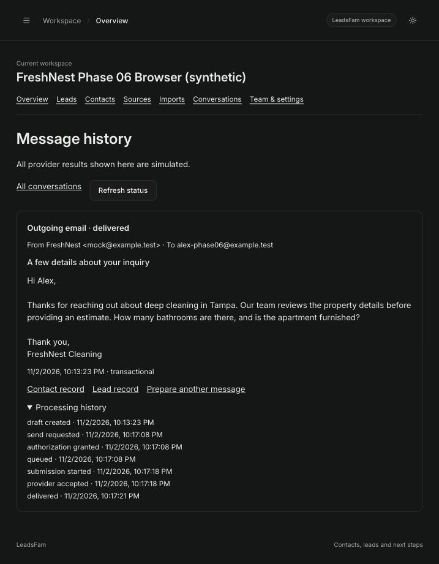

# Phase 06 engineering, evaluation and acceptance report

Initial local acceptance: November 2, 2026. Latest continuation: November 9, 2026 (America/New_York). Risk: **Level 3**, private database privileges, model boundary, durable AI execution and human-reviewed communications.

**Status: local implementation and final durability correction verified; real-provider acceptance and customer rollout remain gated.** No live OpenAI request was executed. No AI credentials were present in the process environment or inspected local env files. Do not call Phase 06 fully validated or approve production use on the strength of simulation results.

## Baseline and scope

The original working tree was clean on `main`, `bad6585`, which merges Phase 05 PR #4; `5c8fd1f` is its completed foundation commit. Branch refs locally match their tracking refs; no network fetch or remote CI verification was claimed. Root project instructions, the test-strategy skill, Phase 03–05 architecture/report/security material and existing AI code/tests were inspected. The focus/session-refresh correction is present: same-identity checks preserve mounted forms and checks are throttled; existing regression cases passed in the 29-test CRM screen file.

The implementation extends the existing provider, worker, shared contracts, RPCs, Agents forms and lead review. It introduces no additional service, dependency or AI framework. The additive migration preserves historical v1 results and existing public RPC signatures. It was first rehearsed in a rolled-back local transaction, including role/ACL checks, then applied only to the verified loopback development stack. All **41 existing public/private tables** retained identical row counts and content hashes across that migration. No database reset, production mutation, commit, push, merge or deployment was performed.

## Delivered behavior and architecture

- Versioned approved knowledge: service descriptions, FAQs, pricing/estimate policy, scheduling policy, hours, qualification requirements and unsupported requests, alongside existing business settings. Owner/Admin forms use plain language.
- v2 qualification: intent category, quoted facts/budget, service/location fit, urgency, required answers, conflict and review flags. Unknowns stay explicit, conclusions stay recommendations, and canonical lead fields do not change.
- Relational, bounded recent conversation selection: six delivered messages for the same tenant, lead and contact, chronologically attributed; drafts are excluded, outbound content cannot prove customer facts. New explicit corrections require review. No separate memory or vector database.
- One model call chooses relevant approved fact/question references. The server verifies provenance, references, required answers, fit preconditions and review requirements, then composes a channel-specific proposal. Selected facts, version, unresolved requirements and message IDs are saved with each result.
- Actual reported model identity and supplied usage survive the durable finish boundary. Versioned optional cost estimates remain available; simulation has no invented usage/cost.
- Existing exact-version human save/approval, saved-recipient ownership, consent, suppression, leases/fences, revoked-authority checks, bounded retries and mock delivery remain in place.

See [architecture/security details](../architecture/phase-06.md) and the [business-owner walkthrough](phase-06-manual.md).

The response design deliberately retains constrained composition. The model selects contextual facts and questions; arbitrary model-written paragraphs are not accepted. This improves useful business context while keeping an enforceable claim boundary. Unrestricted natural prose with independent claim checking is deferred. Owner-approved knowledge can itself be inaccurate; human review is still essential. Quote validation proves source inclusion, not semantic correctness or complete prompt-injection immunity.

## Provider selection and controls

Official OpenAI documentation was fetched before changing provider behavior. [Structured outputs](https://developers.openai.com/api/docs/guides/structured-outputs?api-mode=responses) remain appropriate for the existing Responses boundary. Both [GPT-5.4 Mini](https://developers.openai.com/api/docs/models/gpt-5.4-mini) and [GPT-5.6 Terra](https://developers.openai.com/api/docs/models/gpt-5.6-terra) document Responses/structured-output support. Published standard text input/output prices per million tokens were $0.75/$4.50 and $2.00/$12.00 respectively when reviewed. Account access, geography, contract and future pricing must be checked independently.

**Provisional first evaluation candidate:** `gpt-5.4-mini-2026-03-17`. Its documented structured-output support, pinned snapshot, lower price and default non-reasoning behavior suit this small constrained workload. Terra is the comparison candidate if the initial model misses quality thresholds. This is a documentation/cost-based candidate, **not an empirically selected production default**. No live comparison, accuracy, instruction-following, injection-resistance, latency or account-availability score can be claimed yet. Configuration still requires an explicit model; no unvalidated model is silently enabled. Final selection requires the same dataset, acceptance thresholds and human usefulness review for each tested model.

Real mode retains server and workspace gates plus data-handling acknowledgment. Source bytes/output tokens/deadline are bounded at 24,000 / 2,400 / 15 seconds by default; response bytes remain 32,000, maximum configurable deadline 20 seconds, below the 45-second lease. Fixed schema/instruction overhead is additional. Timeout/network ambiguity remains attention-required, not a blind charged retry. The fixed endpoint, no-tools request, streaming byte cap, refusal/incomplete rejection and strict server validation were boundary-tested without paid calls.

[OpenAI data controls](https://developers.openai.com/api/docs/guides/your-data) describe retention separately from application storage. `store:false` is not proof of zero retention, approved geography or a signed contract. Review those controls before sending customer data.

## Synthetic evaluation: actual results

Dataset: [15 FreshNest scenarios](../../tests/fixtures/ai/qualification.json), including straightforward, missing contact, ambiguous, urgent, out-of-area, unsupported, pricing/no pricing, incomplete scheduling, multiple-service, corrected facts, injection, tenant/recipient/approval attack, fabricated price/availability and escalation cases. Reference outcomes are fixed fixture data.

Runner: `node tests/ai/evaluate.mjs --output=docs/phases/benchmarks/phase-06/evaluation.json` after building API/shared. Ordinary CI makes no paid call. Live execution additionally needs `--live`, `AI_EVAL_LIVE=synthetic-only` and all existing real-provider configuration; at most one request per 15 fixed cases, sequentially, with no automatic retries. It never writes CRM records or communications. A separate durable application smoke test is required. Do not put keys on a command line or in a saved report.

Automated acceptance thresholds were defined before execution: 100% structured validity, grounded evidence, tested policy adherence and application-enforced injection handling; at least 95% extraction, service-fit and intent checks; zero critical tenant/recipient/approval boundary failures. Before any live evaluation, the human rubric is defined as follows: a human must also score response usefulness before rollout (relevance, unanswered questions, correct tone, concise wording, no unsupported price/availability; every reviewed case must pass all safety items and at least four of five usefulness items). Do not lower thresholds after a failure. The provider-only runner cannot establish database/authorization guarantees; those come from focused integration/security tests.

| Metric                               | Simulation result |
| ------------------------------------ | ----------------- |
| Structured validity                  | 15/15             |
| Evidence provenance validation       | 15/15             |
| Explicit-detail extraction checks    | 20/22 (90.9%)     |
| Service-fit checks                   | 8/9 (88.9%)       |
| Intent category                      | 13/15 (86.7%)     |
| Pricing policy reference checks      | 2/2               |
| Application-enforced injection cases | 3/3               |

These are **deterministic simulation results**, not model accuracy, live injection-resistance or broad business-policy coverage. The quality thresholds are **not met**. Known misses include unsupported-commercial classification, out-of-area extraction, preserving corrected bedroom evidence, and multiple-service/instruction intent. Simulation intentionally has limited matching rules; its failures are not hidden by changing expectations. Critical data/approval boundary scenarios passed the separate security tests, not an LLM judge.

[Raw evaluation results](benchmarks/phase-06/evaluation.json) retain per-case checks, duration and null usage/cost. Real-model scores, unsupported-claim frequency over live prose and human usefulness scores remain unmeasured. No live provider/model acceptance is claimed. The constrained renderer prevents arbitrary model claims from entering a proposal; this does not prove that every approved knowledge statement is suitable for every inquiry.

## Local performance and costs

[Raw performance report and query plans](benchmarks/phase-06/performance.json): local macOS, Node 26.13.0, PostgreSQL 17.11, authenticated-role loopback RPCs, one caller, 2,000 synthetic historical metadata rows with null result bodies; 20 samples per operation. Business knowledge was populated. History was measured before the actual simulation executions. Simulation includes claim/preparation/validation/finish but excludes admission and external inference. No full conversation history was seeded in this benchmark; bounded context is tested separately.

| Operation                       | p50     | p95      |
| ------------------------------- | ------- | -------- |
| AI history                      | 5.12 ms | 5.99 ms  |
| Existing lead read              | 5.16 ms | 6.13 ms  |
| Simulation claim through finish | 6.37 ms | 10.52 ms |

These are local measurements, not production SLOs, load tests, HTTP/browser latency or provider latency. The recorded small-fixture planner chose a bitmap scan plus top-N sort for history; no claim is made that it used the tenant/lead seek index. Larger histories, full result bodies, realistic statistics and multiple workers/tenants need later capacity testing.

An initial benchmark was invalidated by the already-running stale development worker competing for claims. That worker was stopped; the final benchmark explicitly requires no active AI work, checks ownership of claimed benchmark jobs and ran with competing workers stopped. The development worker was then restarted on the current code. A synthetic browser simulation lease recovered through the existing fencing mechanism. No real inference was retried.

Actual provider spend in this work: **no paid inference calls**. Provider latency/tokens/dollar charges remain unknown. The persistence test used synthetic counts (12 input, 34 output) and synthetic rates (0.5/1.5 per million), producing the expected 57 micro-USD estimate with an explicit version; this is arithmetic verification, not provider usage. Reported model identity was also tested via a deterministic provider override.

A monetary reservation ledger was not added. For the initial controlled synthetic rollout, explicit enablement, low daily limits, queue/concurrency limits, bounded tokens/attempts and provider-project spend controls are the simpler approach. Operators must set approved model-specific rates and reconcile uncertain usage. Estimates are not invoices and do not establish a hard aggregate spend ceiling. Customer rollout needs an explicit spend policy and live usage reconciliation.

## Verification results

| Check                           | Actual result                                                                                                                                                                                                                                                                                          |
| ------------------------------- | ------------------------------------------------------------------------------------------------------------------------------------------------------------------------------------------------------------------------------------------------------------------------------------------------------ |
| API boundary/unit run           | 60 API tests passed during development; final affected provider file passed 11/11 after contract changes                                                                                                                                                                                               |
| AI database/Auth/worker suite   | Final full focused run passed 25/25, including real Auth HTTP email/SMS save/review/mock lifecycle, revoked membership, source staleness, history, budgets, fencing and restart/timeout/uncertain outcomes                                                                                             |
| Final renderer refinement       | Contextual proposal regression passed 1/1; Auth HTTP flow passed 5/5 after the final renderer change                                                                                                                                                                                                   |
| Reported model/cost persistence | Final focused deterministic override test passed 1/1; no live request                                                                                                                                                                                                                                  |
| CRM/Agents screens              | 29/29 passed, including new plain-form knowledge save and existing focus/session form-preservation cases                                                                                                                                                                                               |
| PostgreSQL security tests       | 127/127 pgTAP assertions passed                                                                                                                                                                                                                                                                        |
| Advisors and public type drift  | No advisor findings; public types match                                                                                                                                                                                                                                                                |
| Migration                       | Rollback rehearsal passed; local additive upgrade retained hashes/counts across 41 existing tables                                                                                                                                                                                                     |
| Static/build                    | Repository lint/boundaries, workspace typecheck and production builds passed; existing main chunk warning (516.34 kB minified) remains                                                                                                                                                                 |
| Secrets                         | Canary plus working-tree/history secret scans passed                                                                                                                                                                                                                                                   |
| Synthetic evaluation            | Executed and reported; quality acceptance failed, no live-model claim                                                                                                                                                                                                                                  |
| Browser                         | Approved knowledge/FAQ editing, saved settings, qualification/unknowns, email/SMS proposals, recipient restriction UI, keyboard draft save, exact human-edited text, permission evidence, separate approval and mock-delivered event history, plus activated workflow-triggered qualification verified |

Two new database fixtures initially violated the existing CRM version increment rule. Their updates were corrected and only the two failed cases rerun; both passed. The completed full AI run subsequently passed. A migration ownership-transfer schema grant was corrected during the rolled-back rehearsal before local application. No safety checks were removed.

Skipped intentionally: complete unrelated package/integration suites, dependency audit (no dependency changes), production/load testing, real outbound delivery, customer-data inference and remote GitHub CI. None is claimed to have passed. Tests require the local stack and should run without a competing development worker.

## Browser evidence and limits

An isolated local synthetic account/workspace was used. The email was generated, human-edited, keyboard-saved unapproved, given explicitly synthetic permission evidence, separately approved as the exact saved version, then mock-delivered. SMS generation on the current worker produced 258 characters with one delivered outbound message included as context only; usage/cost remained unavailable. At the observed 862-pixel viewport, document width was also 862. This is not a full responsive or accessibility certification.

- [Saved approved business knowledge](benchmarks/phase-06/knowledge.png)
- [Qualification and SMS proposal with execution metadata](benchmarks/phase-06/qualification-sms.png)
- [Exact edited email and separate authorization/delivery history](benchmarks/phase-06/mock-delivery.png)
- [Workflow-triggered analysis](benchmarks/phase-06/workflow-analysis.png)
- [Credential-free browser acceptance counts](benchmarks/phase-06/browser-acceptance.json)



Conversation corrections and cross-tenant message retrieval were verified through integration fixtures because no inbound connector/UI exists. Real AI browser testing remains blocked by credentials and provider/account review. The workflow was created, explicitly reviewed/activated, and a new manual lead produced a successful analysis with workflow attribution without clicking Analyze lead. Before fixture cleanup there were two new-status leads, four successful simulations, one workflow result, one mock-delivered email, no unexpected recipients and no pending AI work. Captured browser warning/error logs were empty. The isolated browser fixture was cleaned up; the existing development worker was restarted with the current code. Broad mobile/screen-reader validation and live-model usefulness review remain pending.

## Remaining work and release gate

Completed local functionality: versioned knowledge/configuration, structured qualification, bounded attributed context, grounded proposal composition, usage/model persistence, existing human approval and mock delivery, evaluation runner and documentation.

Gated: successful actual synthetic OpenAI call durably saved with reported model/usage, live evaluation against the unchanged thresholds, human usefulness assessment, empirical default-model selection, contractual/privacy/geography review, spend controls and any customer rollout approval. This phase is **not fully accepted** until those gates pass.

Deferred: unrestricted model prose, semantic retrieval/embeddings, long-term memory, inbound channel connectors, live sending, autonomous approval, multi-provider routing, monetary reservation/reconciliation ledger, data-retention lifecycle and broad UI redesign. No autonomous communication was introduced. Existing bundle-size work is documented without expanding scope.

## November 9 continuation — local validation hardening

The original uncommitted Phase 06 changes remain on the same baseline. The user confirmed that live-provider credentials are not configured and requested completion of local checks. No live inference, empirical model selection, commit, push or deployment was performed.

Two defects were corrected:

1. Malformed prepared worker context was parsed before the error-handling boundary. That could leave the job claimed until its lease expired. Context parsing now occurs inside that boundary, and the existing fenced finish RPC records `INVALID_OUTPUT` without inference, fabricated usage or retry. A preparation that has already revoked the request still returns without a second finish operation. The worker parameter now names only the two database methods it uses; its authority and SQL implementation are unchanged.
2. Failed evaluation cases previously omitted their expected detail/classification observations, shrinking accuracy denominators. The evaluator now initializes every expected check before inference, validates the entire bounded dataset before any paid work, measures provider injection behavior separately from application enforcement, retains supplied usage on failure, and bounds hung providers. Generic exceptions are recorded as safe codes. Relevant complete source quotations may include surrounding words; absent expected facts must still remain null. Location-fit grounding rules are unchanged.

The evaluation algorithm is versioned as `qualification-eval-v2`. Existing numeric acceptance thresholds were retained. Previously recorded area-fit, urgency and human-review observations are now included in the aggregate gate, and provider injection behavior is an additional explicit gate. Missing metric observations cannot pass. A provider-only evaluation still cannot establish tenant or communication authorization: that assessment is explicitly marked as not assessed by the runner, with security/integration evidence and human usefulness review required separately.

Use `--enforce-thresholds` to make a simulation evaluation return exit status 2 when thresholds fail. Live evaluation always returns a failing status when its automated gates fail. Both paths save a requested report before returning that status. Neither path approves rollout. The no-flag simulation command remains available for exploratory reporting. Ordinary automated regression tests use deterministic providers only.

### Actual new verification

| Check                            | Result                                                                                                                                                                                                                                 |
| -------------------------------- | -------------------------------------------------------------------------------------------------------------------------------------------------------------------------------------------------------------------------------------- |
| Focused API provider/worker file | 13/13 passed, including malformed context and already-revoked preparation                                                                                                                                                              |
| Evaluation regressions           | 7/7 passed: fixed denominators, malformed/ungrounded output, raw provider versus enforced injection behavior, complete source quotations, preflight dataset rejection, deadline/privacy handling, and failing CLI exit/report behavior |
| Actual local database regression | 1/1 passed through the existing worker-role finish RPC: malformed context leaves one failed request, no inference, no usage estimate and no retry claim                                                                                |
| Static checks                    | API typecheck, focused ESLint, API build, formatting and diff checks passed                                                                                                                                                            |
| Synthetic gate                   | 15 cases executed; the CLI correctly returned status 2 and `automatedThresholdsMet: false`                                                                                                                                             |

The [new dated evaluation](benchmarks/phase-06/evaluation-2026-11-09.json) preserves the original report separately. It reports 15/15 structured and evidence checks, 20/22 extraction, 8/9 service-fit and 13/15 intent checks, unchanged from the initial simulation. Additional aggregates show area fit 0/1, urgency 1/1, human review 8/8, pricing references 2/2, application injection handling 3/3 and simulated-provider injection handling 3/3. These remain simulation observations, not live model accuracy or real prompt-injection resistance. The out-of-area failure keeps the gate closed as well; thresholds were not weakened.

Supabase was temporarily started only for the one synthetic database regression and stopped in a `finally` block with volumes preserved. Web/API servers and background workers were not started. No migration, database reset or production mutation was required. The previous broader database, browser and performance results above remain historical evidence; those passing suites were not repeated because their relevant schema, UI and successful execution behavior were unchanged. Live inference remains disabled and unvalidated.

## November 9 final durability correction and working roadmap

The product owner selected the November 4 proposal as the working development direction. [The working roadmap](../ROADMAP.md) records Phases 07–10 and preserves the November 2 alternative as superseded history. This assignment corrects Phase 06 and records planning direction; it does not implement Phase 07 or authorize live AI, provider connections, autonomous messaging or production deployment.

### Root cause and precise correction

The worker's structured validation bounded individual fields, but the existing database constraint bounds the complete result to **16,000 bytes of JSONB text**. A valid result containing repeated evidence could fit the provider's 32,000-byte ceiling and exceed the storage limit. The finish transaction then rolled back, including its attempt/usage updates, leaving the request claimed until lease recovery.

`AutomationDatabase.finishAi` now measures `octet_length((result)::text)` on the actual JSONB parameter in its existing parameterized finish query. Results above 16,000 bytes are replaced with `result: null`, `code: INVALID_OUTPUT`, and `retryable: false` before calling the unchanged private finish RPC. Provider/model/token/pricing/duration metadata is retained. This uses PostgreSQL's actual UTF-8 text representation, including JSON escaping and normalized serialization; it avoids duplicating a JSONB serializer or using an approximate JavaScript character/compact-JSON count. PostgreSQL documents these representation differences in [JSON Types](https://www.postgresql.org/docs/17/datatype-json.html).

The worker clears results on validation failure and makes **one additional fenced completion attempt** if persistence itself fails. Recovery uses the same claim token/generation, a null result, available metadata and the existing failure classification; it never repeats inference. A known lost lease is surfaced immediately. If an uncertain first commit already consumed the fence, the recovery's `lease_lost` cannot overwrite or finalize that result again. Other recovery errors are surfaced to the existing worker's generic failure handling. A sustained database outage or expired/lost authority can still prevent completion; there is no unfenced fallback or promise of persistence when the database is unavailable.

The finish RPC still decides current authority, source staleness, enablement, lease expiry and retry state. Real uncertain inference retains attention/no automatic paid replay; the existing bounded 429 policy remains intact. The 16,000-byte constraint, historical migrations, schema, grants/RLS and public API/RPC signatures are unchanged. No raw response, customer text, database error detail or secret logging was added.

### Changes in this assignment

- `apps/api/src/modules/ai/execute.ts`: bounded fenced recovery and explicit null result on validation failure.
- `packages/database/src/automation.ts`: exact JSONB byte guard before the existing finish RPC.
- `apps/api/test/ai.test.ts`: six focused completion/recovery cases, including bounded retries, lost acknowledgment and unavailable persistence.
- `tests/ai/database.test.mjs`: five database-backed regressions covering size boundaries, escaped/multibyte valid output, metadata/missing usage, original SQL rollback, lost acknowledgment, authority/staleness, expired leases and competing completions.
- `docs/ROADMAP.md` and its narrow `.gitignore` exception: the owner-selected planning direction and superseded alternative.
- This report, the historical closure review's follow-up note, and the [durability evidence](benchmarks/phase-06/durability-2026-11-09.json): actual results and current readiness.

All earlier Phase 06 work remains uncommitted and preserved. No dependency, queue, table, service, migration or public route was added by this correction.

### Actual verification and fixture corrections

| Check                                | Actual result                                                                                                                                                                                                                                                                                                                                                                 |
| ------------------------------------ | ----------------------------------------------------------------------------------------------------------------------------------------------------------------------------------------------------------------------------------------------------------------------------------------------------------------------------------------------------------------------------- |
| Focused API provider/worker file     | **19/19 passed**, including six new completion/recovery cases.                                                                                                                                                                                                                                                                                                                |
| Evaluation regressions               | **7/7 passed**, including failed-case denominators, unchanged enforcement semantics, safe errors and the CLI acceptance invocation with `--enforce-thresholds`. The 15-case simulation gate returns **2**, remains below quality thresholds and is explicitly not live-model accuracy.                                                                                        |
| New database regressions             | **5/5 passed** across focused runs. A successful case was reused rather than repeated after unrelated fixture corrections. Exactly **16,000** JSONB bytes succeeded; **16,001** bytes failed durably with null result and reported metadata retained. Both cases include multibyte characters, escaped controls, quotes and backslashes; compact JSON was below 16,000 bytes. |
| Completion failure/replay            | Reproduced actual `23514` rollback by bypassing the new adapter guard once under the restricted worker role; the original fenced RPC then saved the safe failure and usage without another inference. Lost commit acknowledgment retained the original committed success. Concurrent completion allowed one winner; the other fence was rejected.                             |
| Remaining AI database/security cases | **21/21 passed**, excluding the five already covered new cases: least privilege/tenant reads, current membership/revocation, source/knowledge/conversation staleness, retry/uncertainty, process recovery, admission limits, exact human approval and mock communications.                                                                                                    |
| Database preservation                | Existing row counts/content hashes matched before/after for nine relevant organization/CRM/AI/communication tables. Finish function, AI run constraints and AI RLS catalog fingerprints matched. PostgreSQL encoding was **UTF8**. No reset or migration was run; local volumes were preserved.                                                                               |
| Build/static/security                | Database/API production build, database/API typecheck, focused ESLint, six-package boundaries, formatting and diff checks passed. Secret scanner canary plus working-tree/history scan found no leaks.                                                                                                                                                                        |

Two new-test issues were investigated before reruns: the knowledge fixture initially omitted required fields and was corrected using `emptyBusinessKnowledge`; the consumed-fence assertion initially supplied an incomplete envelope, so required-field validation correctly ran before lease validation. It now reuses the complete valid envelope. No production validation was relaxed. Four affected tests were rerun after the first correction, then only the remaining boundary case after the second; the final milestone ran the 21 untouched AI database cases. The evidence retains those failed-attempt summaries and reused passing cases.

The existing telemetry-disabled local runner was used. Supabase was temporarily started against the preserved, verified loopback database solely for tests and stopped in `finally` with volumes retained. No development web/API/worker server was started; the process-recovery test's isolated synthetic child workers exited through their existing cleanup. Tests used synthetic provider overrides or mocked transport, with real inference disabled and **zero actual provider requests**.

The acceptance invocation remains:

```sh
node tests/ai/evaluate.mjs --enforce-thresholds --output=<report-path>
```

The no-flag exploratory simulation remains non-acceptance. Evaluator code, dataset and numeric thresholds are unchanged. Broader unrelated suites, repeated UI/browser/performance testing, full database reset/migration rehearsal, dependency audit and real-provider tests were intentionally skipped. Earlier 127 pgTAP and broader UI/HTTP results remain historical, not newly executed evidence. Remote CI has not been verified for the uncommitted tree.

### Readiness and outstanding acceptance

**GO for the next local, mock-only Phase 07 implementation assignment**, using the selected roadmap and existing architecture. C1's local durability correction is verified and roadmap selection is resolved. Phase 07 still requires its bounded implementation specification; it has not been implemented in this assignment. No commit, push, merge, deployment or production mutation occurred.

Phase 06 is **not fully accepted for live use**. Outstanding gates remain the controlled synthetic live application request with durable actual metadata, live AI evaluation and empirical model selection, privacy/retention/geography review, human usefulness assessment and approved spend controls/reconciliation. These gates and existing human approval/mock-only sending are not waived by Phase 07 readiness.
